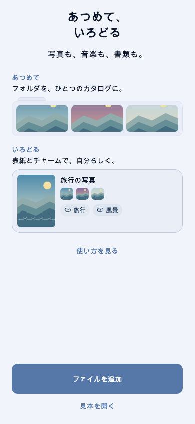
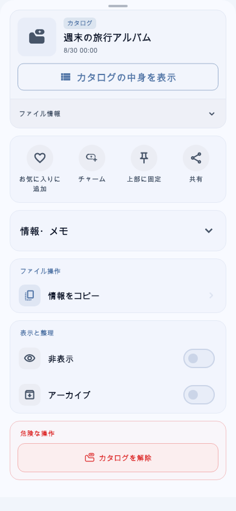

# CharmShelf

[日本語](README.md)

CharmShelf is a Flutter app for organizing and enjoying images, videos, audio, and PDFs on your device. Group files into catalogs and attach charms to make them easier to find.

## Preview

Generated from the actual widgets with synthetic sample data; these are previews, not physical-device screenshots.

| Welcome | Catalog actions |
| --- | --- |
|  |  |

## Features

- Import files and folders; organize them with catalogs, charms, and favorites
- View images and PDFs, and play video and audio
- Search, filter, and sort your library
- App lock, biometric authentication, hidden items, archives, and trash
- Back up and restore a library
- Japanese and English interfaces

## Your data

Library information and settings are primarily stored on the device. Normal development and use do not require a developer account or backend service. Sharing, opening files in other apps, and OS backups can involve external services when initiated by you or the operating system.

Library backups are not encrypted and include hidden, archived, and trashed items. Store them securely and keep separate copies of important originals. See the [privacy policy](docs/PRIVACY_POLICY.md) for details.

## Get started

Use Flutter **3.47.9** and its bundled Dart SDK. Android development requires the Android SDK and a JDK; the iOS simulator requires macOS and Xcode.

From the repository root:

```sh
flutter doctor -v
bash scripts/setup_dev.sh
flutter analyze
flutter test --exclude-tags golden
flutter devices
```

The setup script prepares dependencies, the Isar library used by host tests, and generated configuration, code, and localization files. Initial dependency downloads require network access. No API keys, 1Password account, or store signing credentials are required.

```sh
# Android debug APK
flutter build apk --debug

# iOS simulator build (macOS)
flutter build ios --simulator --debug
```

The standard test command excludes environment-dependent golden image comparisons. For additional UI checks, device execution, and generation commands, see the [setup guide](docs/SETUP_GUIDE.md). Android and iOS are the primary targets. The repository also contains macOS, Windows, Linux, and Web project files; their presence does not establish complete support or verified device behavior.

## Names and build identity

The public app name is CharmShelf. The internal Dart package name `private_shelf` and some native namespaces remain for code compatibility. Builds from this public source use identifiers separate from the former TagShelf distribution. A self-built app does not contain the signing credentials of an existing distribution.

## Contributing and licenses

- [Contributing](CONTRIBUTING.md)
- [Reporting security issues](SECURITY.md)
- [Code of conduct](CODE_OF_CONDUCT.md)
- [Local dependency patches](docs/DEPENDENCY_OVERRIDES.md)

First-party app code is available under the [MIT license](LICENSE). Bundled third-party code, libraries, and assets retain their own licenses. Preserve license and copyright notices in `patches/` when modifying or redistributing them. The app's terms of service and the source-code license are separate documents.
