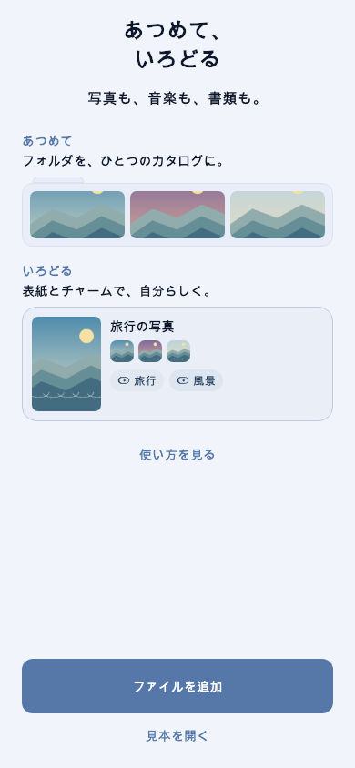
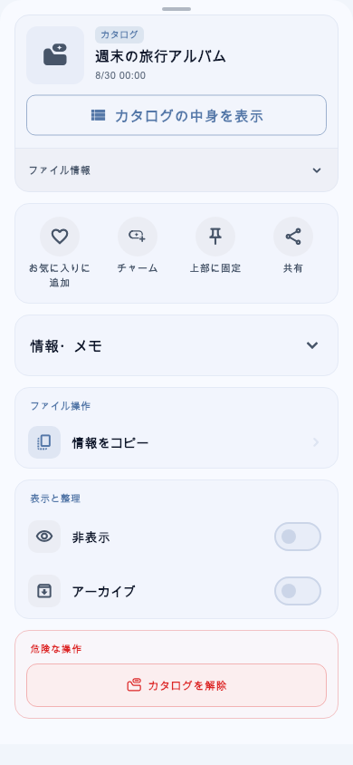

# CharmShelf

[English](README.en.md)

CharmShelf は、画像・動画・音声・PDFを端末内で整理し、楽しむためのFlutterアプリです。ファイルのまとまりを「カタログ」にして、好きな「チャーム」を目印につけられます。

## 画面プレビュー

実際のウィジェットと合成サンプルデータから生成したプレビューです。実機の撮影画像ではありません。

| はじめての画面 | カタログの操作 |
| --- | --- |
|  |  |

## 主な機能

- ファイル・フォルダの取り込みと、カタログ・チャーム・お気に入りによる整理
- 画像・PDFの閲覧、動画・音声の再生
- 検索、絞り込み、並べ替え
- アプリロック、生体認証、非表示・アーカイブ・ごみ箱
- ライブラリのバックアップと復元
- 日本語・英語対応

## データについて

ライブラリ情報と設定は主に端末内に保存します。通常の開発・利用に開発者のサーバーやアカウントは必要ありません。共有、外部アプリで開く、OSバックアップなど、利用者やOSが開始する外部連携があります。

ライブラリのバックアップは暗号化されず、非表示・アーカイブ・ごみ箱の内容も含みます。安全な場所に保存し、重要な元ファイルは別途保管してください。詳しくは[プライバシーポリシー](docs/PRIVACY_POLICY.md)を確認してください。

## 開発を始める

Flutter **3.47.9** と、そのSDKに同梱されたDartを使います。AndroidにはAndroid SDKとJDK、iOSシミュレーターにはmacOSとXcodeが必要です。

リポジトリのルートで実行します。

```sh
flutter doctor -v
bash scripts/setup_dev.sh
flutter analyze
flutter test --exclude-tags golden
flutter devices
```

準備スクリプトは依存関係、ホストテスト用Isarライブラリ、設定・コード・翻訳の生成を準備します。初回はSDK・依存関係の取得にネットワーク接続が必要です。APIキー、1Password、ストア用署名鍵は不要です。

```sh
# AndroidのDebug APK
flutter build apk --debug

# iOSシミュレーター用ビルド（macOS）
flutter build ios --simulator --debug
```

標準テストは描画環境に依存するgolden画像比較を除外します。UI変更時の追加検証を含め、端末への実行方法と生成手順は[セットアップガイド](docs/SETUP_GUIDE.md)を参照してください。主要対象はAndroidとiOSです。macOS・Windows・Linux・Webのプロジェクトファイルも含みますが、対応完了や実機動作を保証するものではありません。

## 名前とビルドの識別

公開アプリ名はCharmShelfです。内部のDartパッケージ名 `private_shelf` と一部のnative namespaceは、既存コードとの互換性のため維持しています。公開ソースのビルド識別子は、旧TagShelfの配布版と分離しています。自分で作成したビルドには既存の配布署名は含まれません。

## 貢献とライセンス

- [貢献方法](CONTRIBUTING.md)
- [セキュリティ上の問題の報告](SECURITY.md)
- [行動規範](CODE_OF_CONDUCT.md)
- [ローカル依存パッチの管理](docs/DEPENDENCY_OVERRIDES.md)

アプリ独自のコードは[MITライセンス](LICENSE)です。同梱する第三者コード・ライブラリ・素材には、それぞれのライセンスが適用されます。改変・再配布時も `patches/` 内のライセンスと著作権表示を保持してください。アプリの利用規約と、ソースコードの利用許諾は別の文書です。
